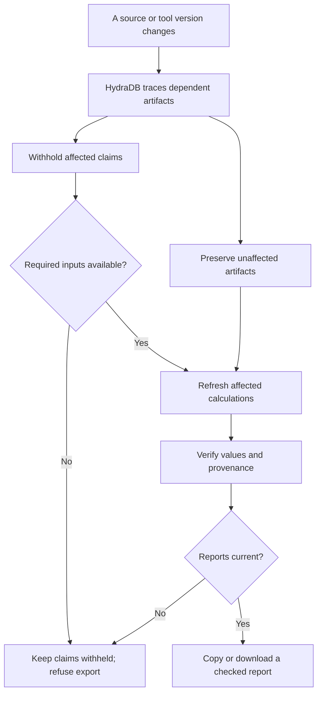
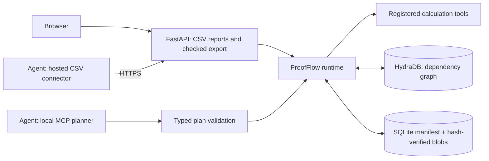

# ProofFlow

**Know when a saved report is stale—and what needs to run again.**

ProofFlow records the source data, tool versions and calculations behind a report. When an input changes, it traces the affected dependencies in **HydraDB**, withholds outdated claims and refreshes affected work. Valid artifacts remain available for reuse.

Use the browser to create company and regional revenue reports from CSV, or connect an MCP agent to inspect evidence and manage corrections. Agents choose plans; registered tools calculate the numbers.

[Showcase](https://proofflow.arnavbule.in/) · [Live demo](https://proofflow.arnavbule.in/app/) · [Two-minute walkthrough](https://proofflow.arnavbule.in/walkthrough.mp4) · [Agent setup](https://proofflow.arnavbule.in/agent/) · [Public evidence](https://proofflow.arnavbule.in/evidence/)


## The correction workflow

An exchange-rate change can invalidate revenue in several reports while leaving their underlying net-revenue and support calculations valid. ProofFlow makes that distinction explicit.



A checked export contains the report and claim IDs and its verification time. It is a snapshot: a later correction can make it historical. Copying or downloading from a stale browser tab is refused by the server.

## Run locally

Requires **Docker with Compose** and **Python 3** for credential initialization. Docker builds the application and starts the pinned HydraDB service.

```sh
git clone https://github.com/saivedant169/proofflow.git
cd proofflow
python3 scripts/init_local.py
docker compose -f docker-compose.yml -f compose.app.yml up -d --build
```

Open [localhost:18080](http://127.0.0.1:18080).

1. Choose **Use your data**, then **Fill with sample CSV** or upload a file.
2. Set exchange rates and a report region. **Validate CSV**, review the preview, then **Create reports**.
3. Use **Update CSV** to change rows or rates, validate, and **Publish correction**. Affected claims become stale.
4. Inspect the evidence, choose **Refresh affected**, then **Copy checked report** or **Download current reports**.

For a built-in example, use **Change a source → Exchange rate → Apply correction** in the guided demo.

Required CSV columns are `order_id,region,currency,gross_cents`; optional columns are `refund_cents,ticket_count`. Amounts use integer cents. Imports support USD, EUR and GBP, with explicit caller-supplied rates, up to **1 MiB and 1,000 rows**. CSV data is sent to and stored by the server you choose. [Full input and API contract](docs/API_CONTRACT.md).

## Connect an agent

| Integration | What it supports | Start here |
|---|---|---|
| Hosted CSV connector | The browser's two fixed revenue reports: create, inspect, correct, refresh and export | [Download, checksum and MCP configuration](https://proofflow.arnavbule.in/agent/) |
| Local typed planner | Compose supported calculations and reports from typed tool contracts; reuse saved artifacts across runs | [Local MCP quickstart](docs/AGENT_QUICKSTART.md#local-typed-planning-setup) |

The hosted connector exposes six tools:

`create_csv_reports` · `inspect_reports` · `inspect_evidence` · `update_csv` · `refresh_reports` · `export_current_reports`

`inspect_evidence` follows the recorded inputs and execution receipts behind a selected artifact, including the native path explaining why it became stale. An agent can inspect retained work before deciding to refresh. The connector runs over stdio in your MCP host; the hosted service itself makes no model calls. [Tool contracts and boundaries](docs/AGENT_QUICKSTART.md).

## Architecture



HydraDB stores the relationships between versioned inputs, execution receipts and immutable artifacts. The artifact store holds their content and identities. For example, an FX version is consumed by a conversion execution that produces a revenue artifact, which a later report consumes.

Refresh processes prerequisites before dependent outputs and binds reports to their current replacements. Missing graph evidence, missing content or unsupported traversal depth causes refusal. There is no in-memory graph fallback. [Design and API details](docs/API_CONTRACT.md) · [Deployment and recovery](docs/DEPLOYMENT.md).

## Evidence and limits

In a frozen **48-invocation model study**—eight cases across six methods—the methods refreshed the following recoverable affected reports:

| Method | Correctly refreshed reports |
|---|---:|
| ProofFlow / native graph | **32/32** |
| Exact-flat dependency traversal | 32/32 |
| Full context | 32/32 |
| BM25 | 25/32 |
| Dense BGE retrieval | 5/32 |
| Iterative hybrid | 28/32 |

The five capped methods share the graph's **per-case evidence allowance** and the same safe executor. This is not a fixed-budget result. Graph used **39.33% of full-context provider input exposure**, excluding the no-op; exact-flat produced identical prompts and matched its outcomes. These observations establish neither unique graph-engine superiority nor measured cost or latency savings. [Protocol, results and usage accounting](docs/MODEL_COMPARISON_RESULTS.md).

The separate deterministic fixed-budget diagnostic is less favorable: at **4,096 / 8,192 evidence tokens**, graph and exact-flat refreshed **15/32 / 27/32**; hybrid reached **28/32** at 8,192. No capped method met the complete-report gate. The original wrapper failures and recovered scores remain documented, as does the earlier retail development efficiency failure. [Fixed-budget results](docs/FIXED_BUDGET_DIAGNOSTIC_RESULTS.md) · [Retail results and failed gate](docs/RETAIL_V2_RESULTS.md).

Other checks establish distinct, bounded results:

- **Hosted agent navigation:** one Fable 5.2 trial passed **8/8** obligations, following typed inputs, explaining a stale FX path and confirming actual artifact reuse. This was a guided two-row fixture on recorded release `327dc60`. [Trial and earlier partial runs](docs/HOSTED_EVIDENCE_NAVIGATION_RESULTS.md).
- **Multi-country correction:** on 933 UK and Belgian rows, ProofFlow and ordinary recalculation both matched **16/16** scheduled outputs. ProofFlow retained four artifact/receipt pairs; comparative compute savings were not established. [Paired results](docs/FRESH_MULTICOUNTRY_RESULTS.md).
- **Release verification:** the verified `34465e9` release passed **575 Python tests**, **nine Chromium workflows**, and external checks covering browser use, HTTP behavior and public evidence downloads. [Release receipts](docs/HOSTED_DELIVERY.md).

The browser runs fixed report recipes with real calculations and native graph traversal; it does not run a live model or benchmark. Recorded experiments are labeled separately. Continual-learning gains, broad generalization and customer adoption remain unmeasured.

## Verify and explore

The [public evidence bundles](https://proofflow.arnavbule.in/evidence/) include checksums and offline verifiers. Inspect saved results without model credentials or repository access; verification does not replay the model experiments.

For local tests and the saved model-result audit, install **Python 3.11+** and **uv**, then run:

```sh
uv sync --frozen --extra test --extra benchmark --extra mcp
uv run pytest -q
python3 scripts/audit_model_comparison_v4.py .
```

| Documentation | Purpose |
|---|---|
| [Agent quickstart](docs/AGENT_QUICKSTART.md) | Hosted connector and local typed planning |
| [API contract](docs/API_CONTRACT.md) | CSV validation, sessions, evidence and checked exports |
| [Model comparison](docs/MODEL_COMPARISON_RESULTS.md) | Six-arm study, controls and limitations |
| [Public evidence guide](docs/PUBLIC_EVIDENCE.md) | Download, checksum and offline verification |
| [Hosted verification](docs/HOSTED_DELIVERY.md) | Exact revisions and observed release checks |
| [Deployment](docs/DEPLOYMENT.md) | Configuration, persistence and recovery |

## License

ProofFlow application code is [MIT-licensed](LICENSE). HydraDB is a separate upstream dependency with its own release license. Credentials and local runtime state are excluded from the repository.
