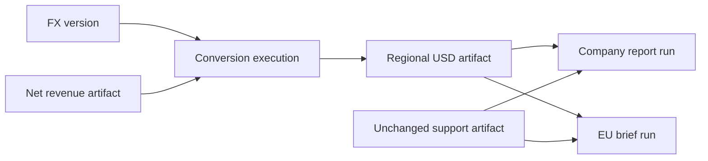

# ProofFlow

**Current evidence for analytics agents.** ProofFlow records the inputs tools actually consume, follows their dependencies in HydraDB, and refreshes saved results when those inputs change—even when another agent run has reused them.

A company report and an EU brief share a revenue calculation. Correct the exchange rate and ProofFlow withholds their outdated claims, shows the dependency path, and recomputes the affected work. The independent support calculation stays reusable.


[Watch the two-minute walkthrough](video/proofflow-walkthrough.mp4) · [Narration and evidence references](docs/VIDEO_SCRIPT.md)

## Run the application

Requires Docker and Python 3 for local credential initialization:

```sh
python3 scripts/init_local.py
docker compose -f docker-compose.yml -f compose.app.yml up -d --build
```

Open **http://127.0.0.1:18080**. Choose **Change a source → Exchange rate → Apply correction**, inspect the affected evidence, then **Refresh affected**.

The guided browser workflow executes real SQLite calculations and native HydraDB traversals on an authored commerce fixture. It does not make a live model call. The Benchmark view includes a separately labeled recording of actual model-chosen plans.

| Result | Before correction | After EUR→USD 1.10→1.20 |
|---|---:|---:|
| Company revenue | $5,565 | $5,755 |
| EU revenue | $2,090 | $2,280 |
| EU support tickets | 2 | 2, same artifact |

Four tools execute during refresh. A missing required source blocks the dependent claims. [Packaged deployment evidence](evidence/deployment_smoke.json) verifies the HTTP workflow and session/artifact persistence after an application-container restart.

## What the benchmark establishes

The comparison was frozen before testing. All methods receive the same records, direct dependency identifiers, scope, exact-ID facility and evidence budget. Dense retrieval uses real `BAAI/bge-small-en-v1.5` embeddings with tokenizer-aware overlapping chunks.

On **12 authored held-out scenarios at 2,048 evidence tokens**:

| Evidence selector | Affected artifact recall | Fresh affected reports |
|---|---:|---:|
| BM25 | 41.4% | 6/29 |
| Dense BGE | 37.5% | 1/29 |
| Iterative hybrid | 63.9% | 9/29 |
| ProofFlow / HydraDB | **87.2%** | **16/29** |
| Exact flat dependency traversal | 87.2% | 16/29 |

The exact dependency control ties ProofFlow. Every selector uses the same **Hydra-assisted currentness and recursive refresh executor**. This measures dependency-based evidence selection, not a unique correctness advantage of the database engine or standalone baseline safety. The fixed budget still leaves some reports unresolved; all-record context completes 29/29. The [complete results](docs/BENCHMARK_RESULTS.md) retain every case, failure, denominator, budget level and raw context.

A separate **16-call actual-model comparison** used Fable 5.2/high with the same prompt and context budget across four prespecified cases. Fresh affected reports were **5/9 for graph**, 2/9 for iterative hybrid, 1/9 for BM25, and 0/9 for dense. These are single-sample, small-workload results; see [model results and usage](docs/AGENT_RESULTS.md).

## An agent can compose the work

In a separate recorded experiment, Fable 5.2 chose a seven-tool company-report workflow from typed tool contracts. Its second request created a new three-claim EU brief using three earlier artifacts and one composition call. An FX correction then refreshed both model-created reports correctly in four tool executions; all **17 execution checks passed**.

The model chooses a bounded plan. Registered tools calculate values; validation rejects unknown handles, forward references, unsupported operations and mismatched claim units. No arbitrary model-generated code or SQL executes. [Plans, receipts and checks](docs/COMPOSITION.md) distinguish the recorded local model run from the guided browser interface.

## Use your own CSV

Install the Python package with the locked development dependencies:

```sh
uv sync --frozen --extra test --extra benchmark
```

The CSV integration runs the same tools on supplied rows, supports a chosen region instead of assuming EU, and preserves versions across imports:

```sh
uv run python scripts/import_csv.py results/import-smoke-v1/input.csv \
  --workspace my-orders --region EMEA --fx EUR=1.10
uv run python scripts/import_csv.py results/import-smoke-v1/input.csv \
  --workspace my-orders --region EMEA --fx EUR=1.20
```

Required columns: `order_id,region,currency,gross_cents`. Optional: `refund_cents,ticket_count`. Monetary inputs are integer cents; provide explicit exchange rates for the currencies used. Imports are bounded to 1 MiB and 1,000 rows, validated before mutation, and reordered identical rows publish no new versions or execution receipts. Every CSV load still performs eight arithmetic preflight checks; zero recorded refresh calls does not mean zero validation work. The example is authored verification data, not a customer dataset. [CSV verification](results/import-smoke-v1/verification.json) records actual native impact and refresh across separate process opens.

Python integrations can use `ProofFlowRuntime.set_source`, `execute`, `currentness`, `affected`, and `refresh` around the supported explicit-input tools. The browser API is documented in [API_CONTRACT.md](docs/API_CONTRACT.md).

## Connect an agent

The local stdio MCP server exposes five tools: load caller CSV, prepare typed evidence, execute a client-selected plan, inspect currentness, and refresh saved work. The host chooses the plan; this server runs no model and accepts no arbitrary code, SQL or filesystem paths.

```sh
uv sync --frozen --extra mcp
.venv/bin/python -m proofflow.mcp_server
```

Configure your host using the [agent quickstart](docs/AGENT_QUICKSTART.md). The [stock-client process check](results/mcp-v1/summary.json) passed 20 checks, including cross-run reuse, changed-source refresh, process restart, stale-plan refusal and unavailable-Hydra errors. CSV validation work is counted separately from recorded refresh calls. This is a trusted local integration, not a public model endpoint.

## How it works

Source versions and tool versions point to executions; executions point to immutable output artifacts. Saved reports consume artifact handles, including outputs from earlier runs. HydraDB performs native dependency traversal and path explanation. Refresh walks prerequisites first and rebinds old handles to their current replacements.

Artifact content lives in hash-verified local blobs with a SQLite manifest. HydraDB stores the relationships. Both persist across restarts. Missing graph evidence, missing content or unsupported depth fails closed; there is no in-memory graph fallback. This tracks currentness for the supported tools, not the truth of arbitrary prose or hidden external dependencies.



## Verify and reproduce

```sh
uv run pytest -q
uv run python scripts/hydra_smoke.py --restart
uv run python scripts/core_smoke.py
uv run python scripts/deployment_smoke.py --restart-app
uv run python -m proofflow.eval.runner --split test --allow-test --output results/reproduction
uv run python scripts/summarize_benchmark.py --input results/reproduction
```

The restart checks act only on this project's Compose services. Benchmark runs refuse to overwrite results, and held-out runs require a clean, committed tracked tree. Local model experiments use the authenticated Claude CLI; their instructions, costs and frozen protocols are documented separately. Ordinary browser use and tests need no model credentials.

- [Methodology and freeze](docs/BENCHMARK_SPEC.md)
- [Native HydraDB persistence evidence](evidence/hydra_smoke.json)
- [Core numeric and cross-run evidence](evidence/core_smoke.json)
- [Deployment and recovery](docs/DEPLOYMENT.md)
- [Browser verification](docs/UI_FIDELITY.md)

The repository remains private. A hosted URL and final submission receipt are not claimed until verified. Local database listeners bind only to localhost; hosted deployments should expose the application through HTTPS and keep HydraDB private. The demo uses one application worker, bounded sessions and a configurable idle expiry.

## License

ProofFlow application code is MIT-licensed. HydraDB is a separate upstream dependency; its own release license applies. Credentials, local state and private planning research are excluded from the source repository.
