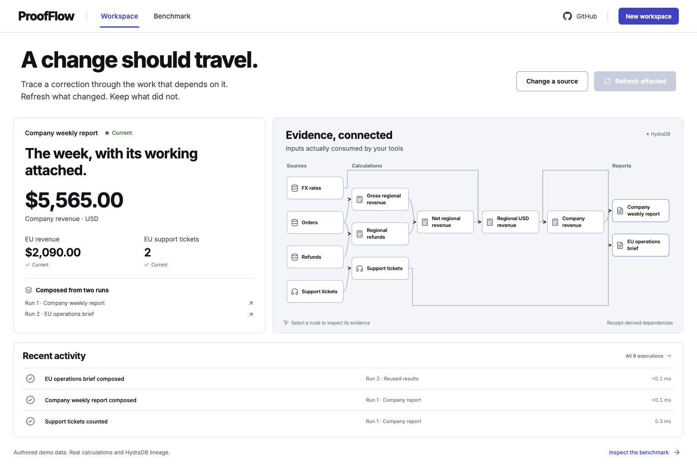
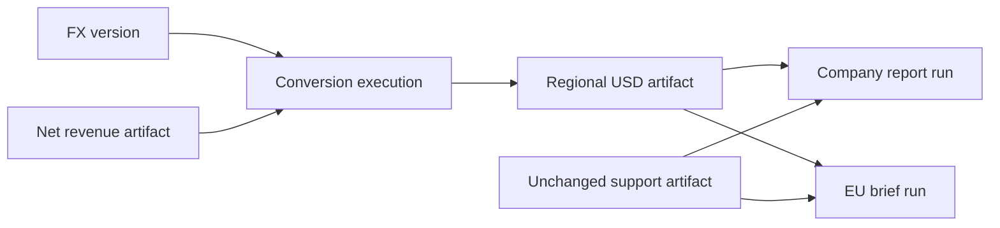

# ProofFlow

**Keep saved agent reports current when an input changes.** ProofFlow records the inputs behind each supported number. Correct an exchange rate or refund, see which saved reports depend on it, and refresh affected calculations while keeping valid work. Try company and regional revenue with a compatible orders CSV, or connect a local MCP host to compose reports from supported tools and reuse earlier results.

**[Open the live app](https://proofflow.arnavbule.in) · [Watch the two-minute walkthrough](https://proofflow.arnavbule.in/walkthrough.mp4) · [Verify the public evidence](https://proofflow.arnavbule.in/evidence/) · [Get the CSV connector](https://proofflow.arnavbule.in/agent/)** · [Hosted verification](docs/HOSTED_DELIVERY.md)

A frozen **48-invocation actual-model comparison** refreshed **32/32 affected reports**, matching full context at **39.33% of its provider input exposure**, excluding the no-op case. BM25 refreshed 25/32, BGE vector retrieval 5/32 and iterative hybrid 28/32 at the graph's per-case evidence allowance. Exact-flat traversal also achieved 32/32 with identical prompts. This is eight fresh cases and one sample per method/case, with a shared safe executor; it establishes neither a unique database-engine advantage nor general model reliability. [Audited model results](docs/MODEL_COMPARISON_RESULTS.md).

The separate fixed-budget diagnostic reused those eight cases with a deterministic reader. At **4,096 → 8,192 receipt tokens**, fresh reports out of 32 were graph and exact-flat **15 → 27**, iterative hybrid **15 → 28**, BM25 **5 → 25**, and BGE **2 → 10**. The uncapped reference refreshed **32/32**. Every capped method missed reports at both limits. The independently recovered scores retain the original wrapper failures. [Fixed-budget diagnostic results](docs/FIXED_BUDGET_DIAGNOSTIC_RESULTS.md).

The [public evidence download](https://proofflow.arnavbule.in/evidence/proofflow-model-evidence.zip) includes the saved model study and a Python standard-library verifier. It checks the source arithmetic, receipt provenance, reported provider counters and historical failures offline, without repository access or model credentials. [Contents, checksum and verification instructions](docs/PUBLIC_EVIDENCE.md).

The delivery evidence ZIP contains 52 payloads covering earlier hosted releases, the January CSV run, the paired workflow comparison, interrupted-update recovery, and the fixed-budget summary and recovery records. Its offline verifier checks the saved evidence. [Delivery archive and verification instructions](docs/PUBLIC_DELIVERY_EVIDENCE.md).

In the audited retail benchmark, the complete dependency path refreshed **38/38 recoverable affected reports** and correctly blocked **4/4 unavailable reports**, using **69.41% fewer evidence tokens than full context**. At the same per-case evidence allowance, BM25 refreshed 19/38, dense BGE 8/38 and iterative hybrid 33/38. Exact flat dependency traversal ties ProofFlow; every arm uses the same Hydra-assisted executor. [Results and limits](docs/RETAIL_V2_RESULTS.md).

In the guided browser sample, a company report and an EU brief share a revenue calculation. Correct the exchange rate and ProofFlow withholds outdated claims, shows the dependency path, and refreshes affected work. The independent support calculation stays reusable. For an external agent, five MCP tools expose source loading, typed planning, inspection and refresh. The browser fixture, deterministic retail benchmark and actual-model experiments are distinct.



[Walkthrough file in this repository](video/proofflow-walkthrough.mp4) · [Narration and evidence references](docs/VIDEO_SCRIPT.md)

The current film briefly shows CSV preview and report creation, then a separately labeled guided correction flow, the audited 48-invocation model comparison and saved actual MCP-client evidence. Earlier deterministic failures remain visible in a separate limits card. The full CSV correction workflow below is a longer live feature. [Verified local video delivery](evidence/video_delivery_v4.json) · [Demo narrative](docs/DEMO_SCRIPT.md).

## Run the application

Requires Docker and Python 3 for local credential initialization:

```sh
python3 scripts/init_local.py
docker compose -f docker-compose.yml -f compose.app.yml up -d --build
```

Open **http://127.0.0.1:18080**. Select **Use your data** for the [CSV workflow](#use-your-own-csv). For the guided sample, choose **Change a source → Exchange rate → Apply correction**, inspect the affected evidence, then **Refresh affected**.

The guided browser workflow executes real SQLite calculations and native HydraDB traversals on an authored commerce fixture. It does not make a live model call. The Benchmark view includes a separately labeled recording of actual model-chosen plans.

| Result | Before correction | After EUR→USD 1.10→1.20 |
|---|---:|---:|
| Company revenue | $5,565 | $5,755 |
| EU revenue | $2,090 | $2,280 |
| EU support tickets | 2 | 2, same artifact |

Four tools execute during refresh. A missing required source blocks the dependent claims. [Packaged deployment evidence](evidence/deployment_smoke.json) verifies the HTTP workflow and session/artifact persistence after an application-container restart.

## Retail benchmark: complete evidence and constrained controls

Retail v2 uses **640 UCI Online Retail positive-sales lines in four dated partitions**, ten authored interventions and declared report compositions. Registered tools perform the calculations; no LLM participates. The frozen test exposes 39 artifacts, including 11 reports, per case. All arms receive the same records, direct dependency identifiers, scope, exact-ID facility, deterministic reader and **Hydra-assisted currentness and recursive refresh executor**. Dense retrieval uses actual `BAAI/bge-small-en-v1.5` embeddings with tokenizer-aware chunks.

The complete dependency path refreshes **38/38 recoverable affected reports**, blocks **4/4 unavailable reports**, and matches full-context values and currentness on every scoped artifact. **10/10 correct endstates includes an expected refusal and a no-op**, not ten newly completed answers. Graph evidence totals **39,375 vs 128,729 full-context tokens: 69.41% fewer**. Its 30.59% ratio passes the unchanged aggregate ≤40% gate; excluding the no-op, the ratio is 33.99%. R06 and R08 exceed 40% individually. Graph, exact-flat and full context each execute 101 tools; the reduction is evidence tokens, not tool calls or measured model cost.

For the comparison below, each case's complete graph closure sets the evidence allowance **before comparator execution**. Allowances vary from **0 to 9,611 tokens**; this is not a fixed 2,048-token result.

| Evidence selector | Mean affected-set recall | Fresh affected reports | Correct endstate cases |
|---|---:|---:|---:|
| ProofFlow / HydraDB | 100.00% | **38/38** | 10/10 |
| Exact flat dependency traversal | 100.00% | 38/38 | 10/10 |
| BM25 | 53.78% | 19/38 | 3/10 |
| Dense BGE | 43.77% | 8/38 | 2/10 |
| Iterative hybrid | 92.91% | 33/38 | 6/10 |

The separate **fixed 2,048-token diagnostic** remains incomplete:

| Evidence selector | Fresh affected reports | Correct endstate cases |
|---|---:|---:|
| ProofFlow / HydraDB | 8/38 | 2/10 |
| Exact flat dependency traversal | 8/38 | 2/10 |
| BM25 | 1/38 | 2/10 |
| Dense BGE | 0/38 | 2/10 |
| Iterative hybrid | 4/38 | 2/10 |

Every fixed-budget arm's two correct endstates are the **expected-refusal case R07 and no-op R09**. None is a fully refreshed affected-report case. Missing-source blocking and zero incorrect-current artifacts are shared executor properties, not unique graph-planner successes.

The **development efficiency gate failed**: graph/full evidence was **60.79%**, above the unchanged 40% threshold; excluding its no-op gives 81.07%. Development correctness passed, but that failure is retained and is not pooled with held-out test. Exact-flat traversal ties the graph on all test endstates. The result supports explicit dependencies, not exclusive correctness from the storage engine. FX, refunds and corrections are staged assumptions over a bounded positive-sales sample, not observed historical incidents or customer validation.

[Audited results, all cases and raw records](docs/RETAIL_V2_RESULTS.md) · [Frozen protocol](docs/RETAIL_V2_SPEC.md) · [Machine-readable summary](evidence/retail_v2_summary.json) · [Dataset attribution](fixtures/retail_v2/DATASET_NOTICE.md)

## Earlier pilots, reported separately

The original deterministic pilot used **12 authored scenarios at 2,048 evidence tokens**. Fresh affected reports were graph **16/29**, iterative hybrid **9/29**, BM25 **6/29**, dense **1/29**; exact-flat tied graph and full context completed 29/29. Graph's affected-artifact recall was 87.2%. These cases are not pooled with retail v2. [Original results](docs/BENCHMARK_RESULTS.md).

The separate **16-call actual-model pilot** used Fable 5.2/high across four prespecified cases, with the same prompt and evidence budget. Graph completed **5/9**, iterative hybrid **2/9**, BM25 **1/9**, dense **0/9** affected reports. All sixteen planning attempts completed without model failure or abstention; graph still left four recoverable reports unresolved. This single-sample pilot does not establish broad model-performance, latency or cost superiority. [Model results and usage](docs/AGENT_RESULTS.md).

## An agent can compose the work

In a separate recorded experiment, Fable 5.2 chose a seven-tool company-report workflow from typed tool contracts. Its second request created a new three-claim EU brief using three earlier artifacts and one composition call. An FX correction then refreshed both model-created reports correctly in four tool executions; all **17 execution checks passed**.

The model chooses a bounded plan. Registered tools calculate values; validation rejects unknown handles, forward references, unsupported operations and mismatched claim units. No arbitrary model-generated code or SQL executes. [Plans, receipts and checks](docs/COMPOSITION.md) distinguish the recorded local model run from the guided browser interface.

## Use your own CSV

In the running app, select **Use your data**, choose a UTF-8 file or paste the complete CSV, supply the required EUR/GBP→USD rates, and select the report region. Choose **Validate CSV**, inspect the non-persisting preview, then **Create reports**. The guided calculation creates company and selected-region net-revenue reports; it makes no live model call or arbitrary query. CSV contents are sent to this ProofFlow server and saved in an isolated imported workspace.

The import form includes **Fill with sample CSV** and **Download sample CSV** to try the exact supported format. The numbered workspace controls guide a correction through publication, affected refresh and a checked report download. The separate support calculation remains inspectable.

Use **Update CSV → Validate CSV → Publish correction** to replace the full input. Publishing changes source versions and withholds affected revenue; **Refresh affected** performs the calculations, and **Check values** verifies the result. Reordered identical rows preserve artifact identities and record no refresh calls. **Guided demo** and **Open your CSV** switch between independent workspaces. The selected region stays fixed within an imported workspace; **Import another CSV** starts one for another region. After a page reload, reselect or paste the complete CSV when updating; saved workspace values and rates persist, but the upload form does not repopulate the CSV text.

For a handoff, choose **Copy checked report**, then paste the snapshot into your update. Use **Download current reports** to save the same plain text as a file, including when your browser denies clipboard access. Either action checks the displayed workspace generation and both report IDs on the server, and proceeds only while both reports and their revenue claims are current. The snapshot contains company and selected-region net revenue in USD, their immutable report and claim artifact IDs, and the UTC check time. It stays fixed at that time. A correction in another tab can block a copy or download from the older tab. [Hosted clipboard and download checks](docs/HOSTED_DELIVERY.md).

A separate [small-file workflow comparison](docs/WORKFLOW_COMPARISON_RESULTS.md) gives ordinary full recalculation a latest-version guard. Both methods matched all eight outputs through two corrections and rejected all four stale handoffs. ProofFlow retained four artifact heads and receipts after the FX correction and two after the refund correction, with native paths explaining both reports' dependencies. Its additional validation and verification are counted; this probe establishes neither faster computation nor analyst time savings.

Browser verification against Docker revision `a2eb61b` covered NORTH revenue changing from **$308 company / $108 regional** at EUR 1.20 to **$317 / $117** at 1.30, with four refresh calls; a zero-support APAC input produced **$163.75 / $93.75** without inventing a support claim. Malformed and oversized input was rejected, including after a valid preview. Imported state survived application restart, and the flow was inspected at 390px and 1536px widths. These are authored functional cases, not additional benchmark results. [Browser checklist and captures](docs/UI_FIDELITY.md#browser-csv-import-verification).

The original automated Chromium suite passed **six browser workflows** against real HydraDB, including session isolation, lost responses and repair after partial source publication. The same FX test detects an intentionally injected one-cent error. Both an earlier assertion-label failure and the first negative-control teardown failure are retained. [Browser acceptance evidence and reproduction](docs/BROWSER_ACCEPTANCE_RESULTS.md).

The expanded local suite passed **nine workflows**, adding checked report downloads, stale-tab refusal, unavailable-response handling and exact large monetary values. The original arithmetic control still detects both one-cent errors. [Report handoff acceptance and scope](docs/REPORT_HANDOFF_ACCEPTANCE.md).

One hosted Chrome run on `92da58c` uploaded **642 UCI Online Retail positive-sales lines** from January 16, 2011. Those invoice lines were new to the prepared workflows. A staged GBP rate correction changed the company and UK figures from **$9,052.58 to $9,414.68**, matching the independent oracle. The old tab’s download was refused, and the checked replacement persisted on reload. All sales lines were from the United Kingdom, so the two report figures coincide. [Hosted retail CSV results and scope](docs/REAL_PARTITION_RESULTS.md).

One preview followed by creation performs **8 preview preflight + 8 create preflight + 8 recorded calls + 11 verification calculations = 35 calculations**. The creation response alone reports 27; preview is a separate operation. Updates validate again but do not automatically refresh. Counts cover registered arithmetic invocations, not all parsing, storage or graph-query work.

The importer accepts at most **1 MiB, 1,000 order rows and 10,000 total ticket counts**, with USD/EUR/GBP, unique order IDs and one currency per region. Money is nonnegative integer cents; refunds cannot exceed gross amounts. Imported USD cents outside JavaScript’s safe integer range reach the browser as decimal strings for exact display. Exchange rates are supplied by the caller, not fetched. Both browser reports contain revenue only; support remains a separate artifact. The same schema is available through the CLI below and the [five-tool MCP interface](docs/AGENT_QUICKSTART.md).

### Command-line import

Install the Python package with the locked development dependencies:

```sh
uv sync --frozen --extra test --extra benchmark
```

The CSV integration runs the same tools on supplied rows, supports a chosen region instead of assuming EU, and preserves versions across imports:

```sh
uv run python scripts/import_csv.py results/import-smoke-v1/input.csv \
  --workspace my-orders --region EMEA --fx EUR=1.10
uv run python scripts/import_csv.py results/import-smoke-v1/input.csv \
  --workspace my-orders --region EMEA --fx EUR=1.20
```

Required columns: `order_id,region,currency,gross_cents`. Optional: `refund_cents,ticket_count`. Monetary inputs are integer cents; provide explicit exchange rates for the currencies used. Imports are bounded to 1 MiB and 1,000 rows, validated before mutation, and reordered identical rows publish no new versions or execution receipts. Each successful two-report CLI invocation performs **16 arithmetic preflight calculations** (eight while parsing and eight at the public import boundary), plus **11 report-verification calculations**, separately from its recorded runtime calls. A row-order-only replay can have zero recorded refresh calls while still performing those 27 validation/verification calculations. The example is authored verification data, not a customer dataset. [CSV verification](results/import-smoke-v1/verification.json) records actual native impact and refresh across separate process opens.

**Accounting correction:** earlier documentation described all CSV loads as eight preflight calculations. That is correct for MCP `load_csv`, but understated work the CLI already performed. The CLI now exposes `preflight_calculation_count`, `recorded_tool_call_count`, `verification_calculation_count` and their `total_calculation_count`. Original raw captures are retained unchanged; benchmark results and the MCP experiment's **16 preflight calculations across two loads** are unchanged. These counts cover arithmetic tool invocations, not all parsing, storage or graph-query work.

Python integrations can use `ProofFlowRuntime.set_source`, `execute`, `currentness`, `affected`, and `refresh` around the supported explicit-input tools. The browser API is documented in [API_CONTRACT.md](docs/API_CONTRACT.md).

## Connect an agent

### Hosted CSV connector

The downloadable Python connector lets a local MCP host create, inspect, correct, refresh and export the same two guided CSV revenue reports as the browser. Install `uv` and use Python 3.11 or newer. Verify the script against its companion checksum and configure the host to launch it over stdio. The connector sends the supplied CSV to the demo service over HTTPS and opens one session per process. The service expires idle sessions after one hour. No repository checkout, ProofFlow account or HydraDB key is required. [Connector setup](https://proofflow.arnavbule.in/agent/) · [Python script](https://proofflow.arnavbule.in/agent/proofflow_csv_mcp.py) · [Checksum](https://proofflow.arnavbule.in/agent/proofflow_csv_mcp.py.sha256).

An external runner downloaded the connector, matched its bytes to the release, and discovered all five tools with a stock MCP client in a fresh environment. An earlier stock-client run using the same script against the live CSV API passed 21 checks, including stale and cross-session export refusal. Both runs used scripted clients. [Delivery and check scopes](docs/HOSTED_DELIVERY.md).

In one separate guided model trial, Fable 5.2 created and inspected the two reports from the 642-row retail CSV. That verified **2 of 7** planned steps at **$9,052.58** company and UK revenue. The model stopped before correction, citing its budget estimate. Five steps remained unattempted. [Partial result and protocol](docs/HOSTED_CONNECTOR_MODEL_V1_RESULTS.md).

### Local typed planning and composition

The local stdio MCP server exposes five tools: load caller CSV, prepare typed evidence, execute a client-selected plan, inspect currentness, and refresh saved work. The host chooses the plan; this server runs no model and accepts no arbitrary code, SQL or filesystem paths.

```sh
uv sync --frozen --extra mcp
.venv/bin/python -m proofflow.mcp_server
```

Configure your host using the [agent quickstart](docs/AGENT_QUICKSTART.md). The [stock-client process check](results/mcp-v1/summary.json) passed 20 checks, including cross-run reuse, changed-source refresh, process restart, stale-plan refusal and unavailable-Hydra errors. This check uses caller-supplied plans and makes no model calls. CSV validation work is counted separately from recorded refresh calls. This is a trusted local integration, not a public model endpoint.

A real **Fable 5.2/high Claude Code client** then completed one corrected MCP trajectory with **32 recorded checks passed**: nine MCP requests across ten CLI turns, two client-chosen reports, cross-run reuse, source correction, stale inspection and refresh. It executed seven initial tools, one reused-artifact composition and four refresh tools: **12 recorded calls**, plus **16 CSV arithmetic preflight checks**. The server makes zero model calls; the external client makes the model calls.

The [first attempt](results/mcp-agent-v1/README.md) remains a configuration failure: its launch suppressed MCP tool discovery and produced zero tool calls. The corrected attempt used the same task, apart from a fresh workspace nonce. Provider list accounting totals **$0.847042 across both attempts** ($0.809898 corrected, $0.037144 failed). This is one authored two-row integration, not a general agent benchmark or subscription billing statement. [Client evidence and audit](docs/MCP_AGENT_RESULTS.md).

## How it works

Source versions and tool versions point to executions; executions point to immutable output artifacts. Saved reports consume artifact handles, including outputs from earlier runs. HydraDB performs native dependency traversal and path explanation. Refresh walks prerequisites first and rebinds old handles to their current replacements.

Artifact content lives in hash-verified local blobs with a SQLite manifest. HydraDB stores the relationships. Both persist across restarts. Missing graph evidence, missing content or unsupported depth fails closed; there is no in-memory graph fallback. This tracks currentness for the supported tools, not the truth of arbitrary prose or hidden external dependencies.



## Verify and reproduce

```sh
python3 scripts/audit_model_comparison_v4.py .
uv run pytest -q
uv run python scripts/hydra_smoke.py --restart
uv run python scripts/core_smoke.py
uv run python scripts/deployment_smoke.py --restart-app
PROOFFLOW_HYDRA_TOKEN_FILE=.state/hydra-token uv run python scripts/recovery_probe.py --output results/recovery-reproduction
uv run python -m proofflow.eval.runner --split test --allow-test --output results/reproduction
uv run python scripts/summarize_benchmark.py --input results/reproduction
uv run python scripts/summarize_retail.py
```

The restart checks act only on this project's Compose services. Benchmark runs refuse to overwrite results, and held-out runs require a clean, committed tracked tree. Local model experiments use the authenticated Claude CLI; their instructions, costs and frozen protocols are documented separately. Ordinary browser use and tests need no model credentials.

The recovery probe uses fresh disposable workspaces and kills only its own API child between two source publications. The first frozen attempt passed 15 checks: restart withheld affected values, full CSV resubmission restored the uninterrupted control's values and lineage, and support stayed current. Refresh recorded seven tool calls; complete lifecycle accounting was 61 calculations for control and 69 with interruption. The extra eight were validation completed before the kill. This is one process-interruption case, not a general crash-safety guarantee. The command requires the running local Hydra service, committed probe/source files and a new output directory. Cookies and state remain private; curated observations are separate.

- [Retail protocol and freeze](docs/RETAIL_V2_SPEC.md)
- [Original pilot methodology](docs/BENCHMARK_SPEC.md)
- [Native HydraDB persistence evidence](evidence/hydra_smoke.json)
- [Core numeric and cross-run evidence](evidence/core_smoke.json)
- [Interrupted-update protocol and result](docs/RECOVERY_V1_RESULTS.md)
- [Hosted HTTP, browser and restart checks](docs/HOSTED_DELIVERY.md)
- [Deployment and recovery](docs/DEPLOYMENT.md)
- [Browser verification](docs/UI_FIDELITY.md)

The repository remains private. The hosted demo uses HTTPS, one application worker, bounded sessions and a configurable idle expiry. Local database listeners bind only to localhost. The live demo is separate from judge access to the private source and from submission through the organizer's form.

## License

ProofFlow application code is MIT-licensed. HydraDB is a separate upstream dependency; its own release license applies. Credentials, local state and private planning research are excluded from the source repository.
